# MineVerse · 方块宇宙

一个从零实现的浏览器体素沙盒（Minecraft 风格核心复刻）：**TypeScript + Three.js + WebGL2**，程序化生成的无限地形、方块光照与 AO、生存闭环、创造模式、8 种生物与战斗、完整像素 UI 与存档。

> 原创粉丝作品：所有贴图、模型、音效均由代码程序化生成，不使用 Minecraft 官方素材、Logo 或音乐。

**在线游玩**：<https://freefoxcm.github.io/mineverse/>（GitHub Pages）
**源码仓库**：<https://github.com/freefoxcm/mineverse>

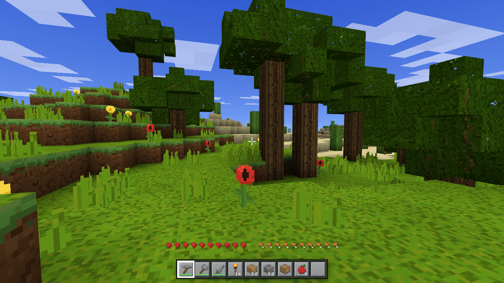

## 截图

| | |
|---|---|
| 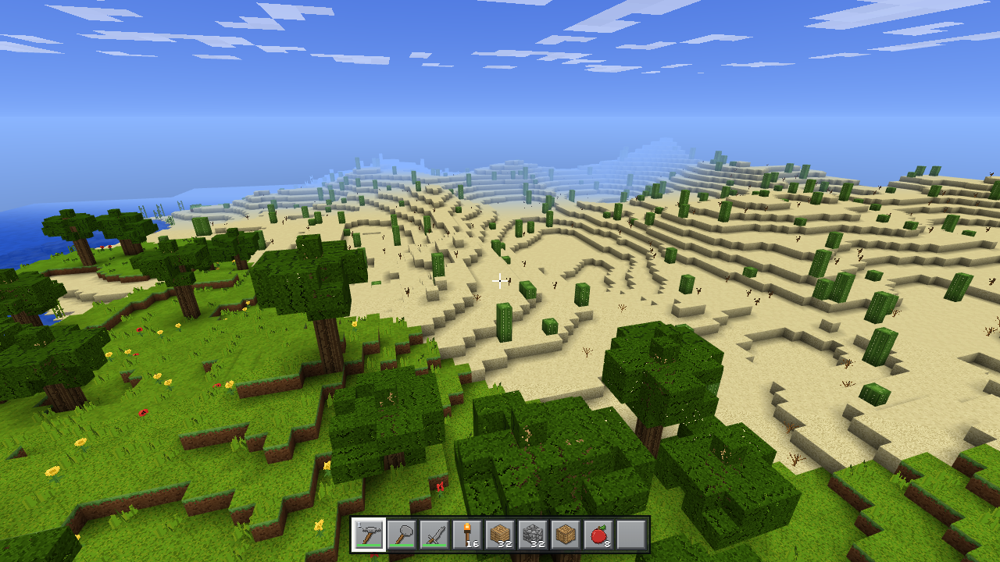 | 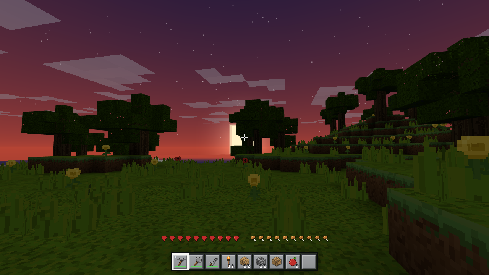 |
| 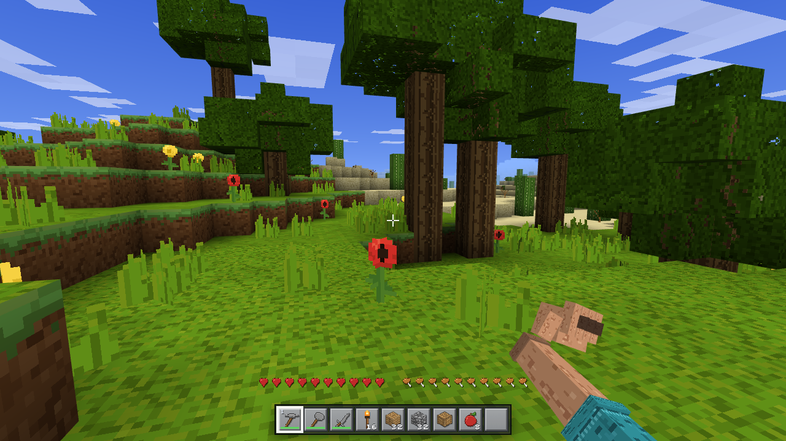 | 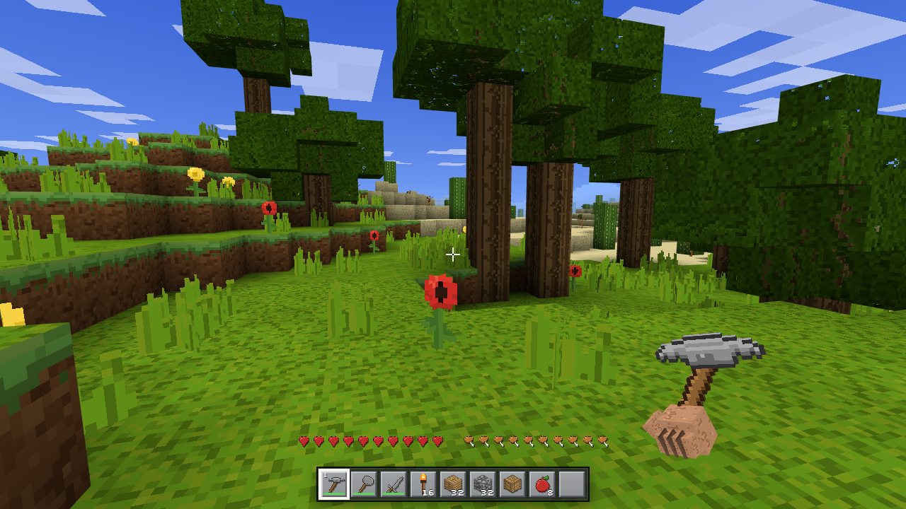 |
| 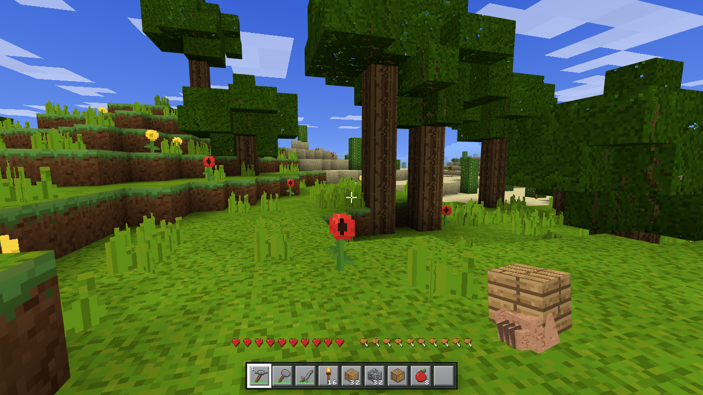 | 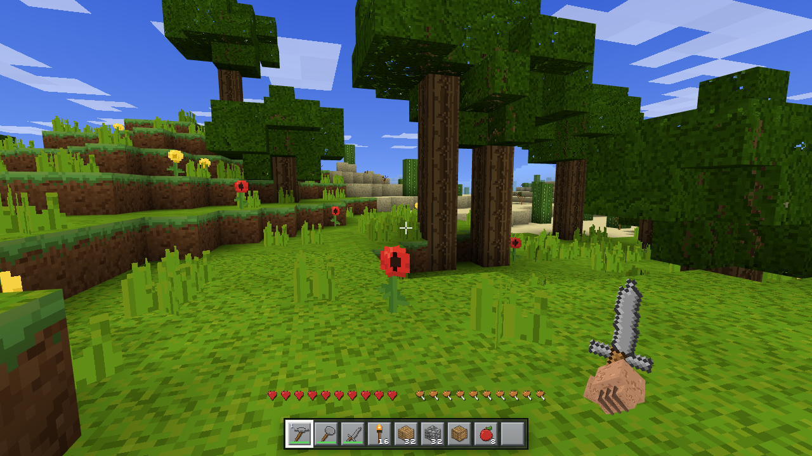 |
| 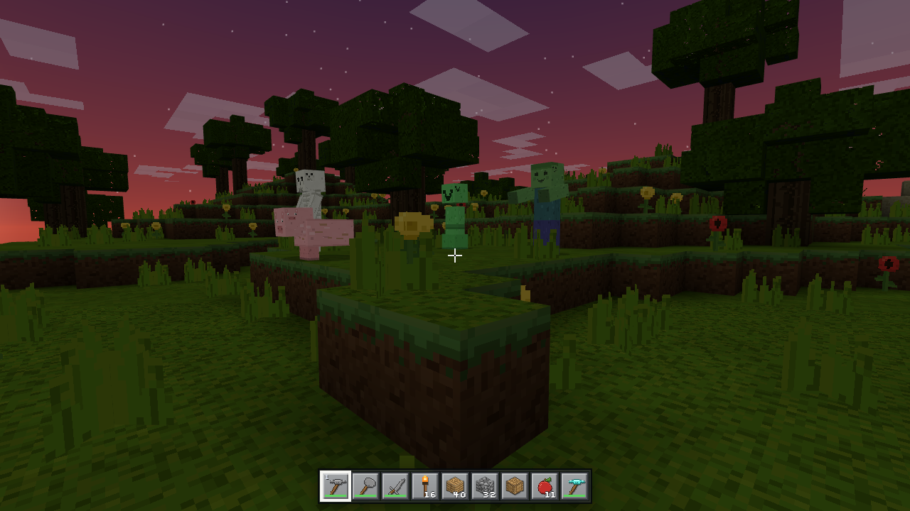 | 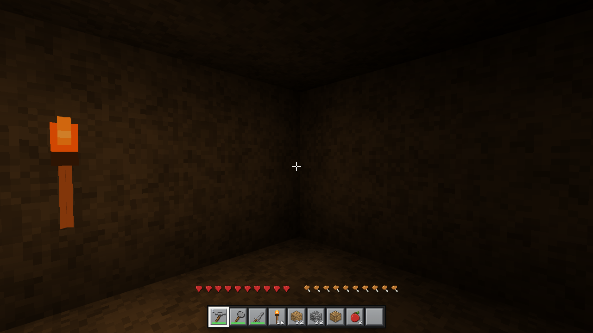 |
| 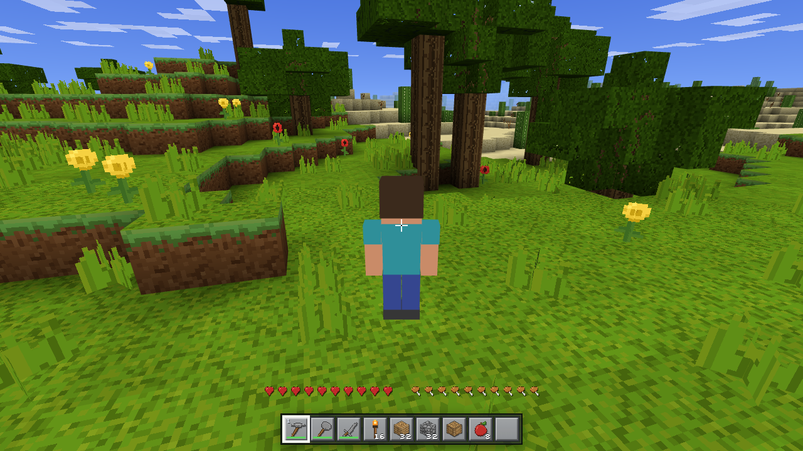 | 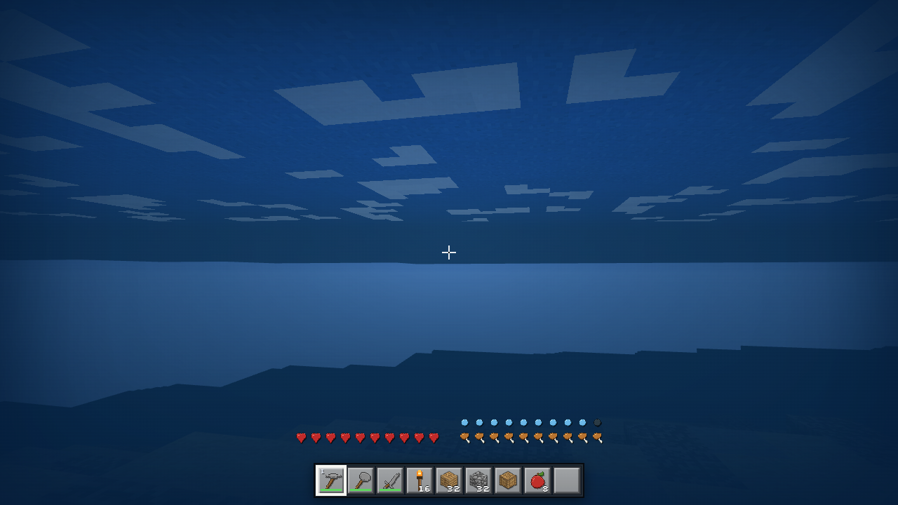 |
| 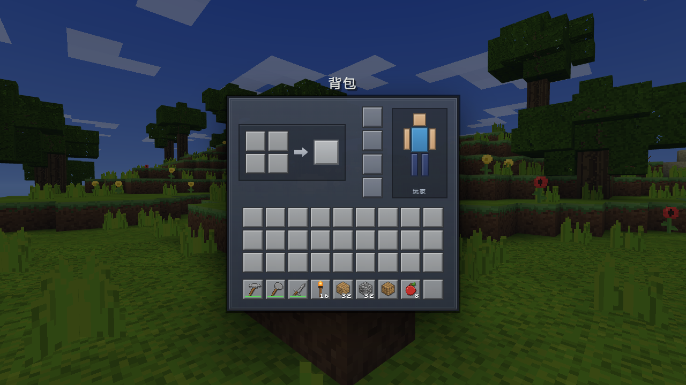 | 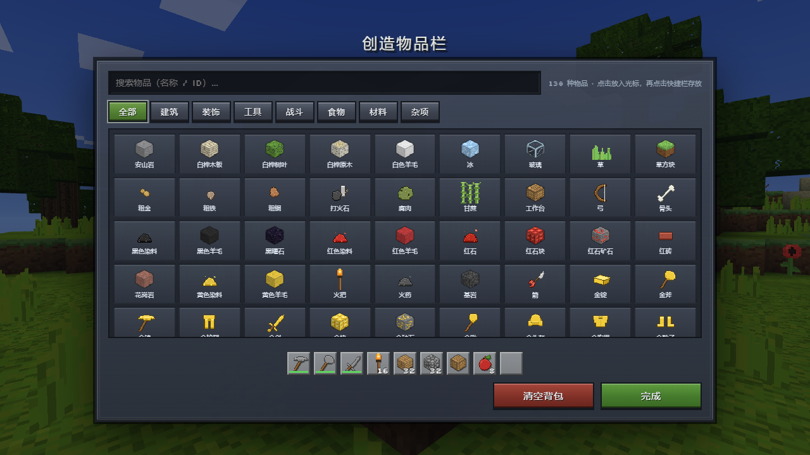 |
| 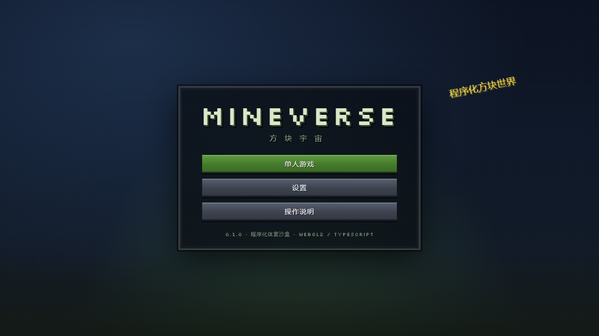 |  |

## 特性

### 世界与渲染
- 无限水平世界：16×16×160 区块列、海平面 63、种子确定性生成；以玩家为中心的螺旋流式加载/卸载（RD 4–12，默认 8）。
- 10 种生物群系（平原/森林/白桦林/针叶林/沙漠/雪原/山地/海洋/沙滩等）、3D 洞穴、七种深度矿脉。
- 有机景观：不规则分层树冠（橡树/白桦/云杉/大橡树）、花簇与高草密度按群系变化、山地/水边裸石与砂砾斑块；跨区块确定性生成。
- **16px 逻辑像素风材质**：32px 画布上以 2×2 硬边块绘制，首个 mipmap 即干净的 16×16 原图；Nearest mipmap 过滤，避免远景发糊。
- **光照与氛围**：逐面明暗 + 平滑光照 + AO、天光/方块光 BFS、暖色方块光、轻度饱和度/对比度校正、生物群系 grass/foliage tint、随机 UV 旋转打散重复纹理。
- 天空：渐变天穹、块状云层、太阳光晕、月亮、星空；昼夜/日落过渡、雾、水下滤色、水面微动画。
- WebGL2 纹理数组（逐 tile 分层，无图集接缝）、42 种 WebAudio 程序化音效、程序化像素美术（89 方块纹理 / 75 物品图标 / 26 UI 贴图 / 29 生物皮肤）。

### 玩法
- 新世界初始补给：石镐/石斧/石剑、16 火把、32 木板、32 圆石、工作台、8 苹果（创造模式改为 9 组建筑方块）；URL 加 `?kit=0` 可关闭。
- 空手：与原版一致，第一人称始终显示玩家的皮肤手臂（纹理前臂 + 拳头/指节 + 袖口；待机微动/挥拳/行走摆动），可徒手挖掘与攻击；截图模式可临时隐藏。
- **第一人称 3D 手持物**：工具/武器/食物按 32×32 图标 alpha 轮廓挤出真实厚度（正面/背面/侧面），方块有六面明暗，物品以斜 3/4 姿态 + 握持拳头呈现；挥动绕握点旋转，不再是平面贴片。
- 生存：生命/饥饿/饱和度/护甲/氧气、摔落/溺水/岩浆/生物伤害、死亡掉落与重生、工具耐久、熔炉、箱子、工作台。
- 合成：81 条配方（2×2 背包 / 3×3 工作台、有序/无序、自动偏移、不镜像）+ 14 条熔炼配方与燃料表。
- 创造模式：飞行、无限方块、即时破坏、创造物品栏（分类 + 搜索）。
- 生物：僵尸、骷髅、苦力怕、蜘蛛、猪、牛、羊、鸡；3D A* 寻路、刷怪规则、骷髅射箭、苦力怕自爆、TNT 爆炸真实破坏地形。
- 交互：DDA 射线选取、挖掘进度/裂纹、方块朝向放置、食物、打火石、弓箭、粒子与音效。
- 掉落物：非方块物品使用物品图标 billboard（朝向相机、浮动），方块物品保持迷你方块模型，不再用纯色方块表示。
- 第一人称手持物品/挥动动画，以及 F5 第三人称方块角色模型；空手时显示皮肤手臂（与原版一致）。

### 工程
- 存档：IndexedDB 多世界、只保存地形改动（edits）+ 方块实体、自动保存 60s、导出/导入 JSON。
- 命令：`/help /seed /time /gamemode /tp /give /kill /clear /spawnpoint`。
- 调试 API `window.__MC__`：世界/玩家/背包/UI/实体/存档的自动化控制，用于 E2E 与截图。
- 测试：430+ 条 Vitest 单元测试；Playwright 无头 Chromium E2E（27 张截图 + 31 项功能断言）；`scripts/photos.mjs` 生成文档截图。

## 运行

要求：Node 20.19+ / 22.12+（在 Node 24 验证），支持 WebGL2 的现代浏览器。

```bash
pnpm install
pnpm dev          # http://127.0.0.1:5199
pnpm build        # 生产构建到 dist/
pnpm preview      # 预览生产构建
pnpm typecheck
pnpm test
pnpm e2e          # 无头截图/功能回归（先 build）
pnpm deploy       # 发布到 GitHub Pages 并做线上冒烟
```

## 操作

| 按键 | 功能 |
|---|---|
| WASD | 移动 |
| 空格 | 跳跃；创造模式双击切换飞行 |
| Shift | 潜行 / 飞行下降 |
| Ctrl 或双击 W | 疾跑 |
| 鼠标左键 | 破坏方块 / 攻击 |
| 鼠标右键 | 放置方块 / 使用 / 进食 / 拉弓 |
| 鼠标中键 | 选取方块（创造） |
| 1–9 / 滚轮 | 选择快捷栏 |
| E | 背包 / 合成 |
| Q | 丢弃物品 |
| T 或 / | 聊天 / 命令 |
| Esc | 暂停菜单 |
| F3 | 调试信息 |
| F5 | 第一/第三人称 |
| 左/右键 + Shift | 快捷转移物品 |

## 架构

```text
src/core        常量/类型/契约/RNG/设置/命令
src/world       注册表、区块、世界、地形/光照/网格/Worker/流式加载
src/render      渲染器、纹理数组、地形材质、天空、区块/实体/第一人称/第三人称渲染
src/player      玩家、物理、输入、交互、粒子
src/inventory   背包、配方、合成、容器/熔炉
src/entities    实体、生物 AI、寻路、刷怪、箭、爆炸、掉落物
src/ui          HUD 与全部界面
src/art         程序化像素纹理/图标/皮肤
src/save        存档 schema、EditStore、IndexedDB
src/debug       自动化 API
```

详见 [docs/ARCHITECTURE.md](docs/ARCHITECTURE.md)、[docs/CONTRACTS.md](docs/CONTRACTS.md)、[docs/PLAN.md](docs/PLAN.md)。

## 性能

RD8 / 293 区块列 / 760 个网格 / 212 draw calls / ~115k 三角形。区块生成约 3.8 ms/列、网格约 3.5 ms/段（Worker 内）。生产环境建议使用独立显卡或较新集显；可在设置中降低渲染距离。

## 已知限制（一期范围外）

单人；无红石、下界/末地、村民/交易、附魔/经验、农耕、船/矿车、楼梯/半砖/门、天气、移动端触屏。
生物群系 tint 目前只作用于草方块顶面/树叶/水面（轻度），未做原版整块色调映射。
存档仅保存方块改动与玩家/容器状态，不保存生物/掉落物实体；掉落物目前用简化色块表示。

## 许可

代码与程序化素材为原创作品。默认未附开源许可证；如需 MIT/Apache 等请告知作者。
